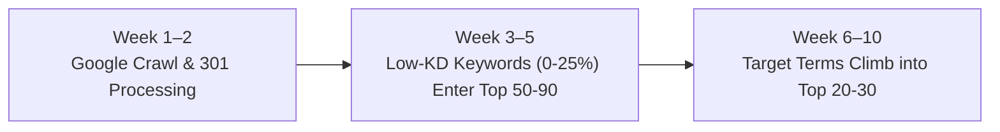

# Semrush Position Tracking Analysis & SEO Growth Roadmap

**Project**: `www.scalepods.co` / `scalepods.co`  
**Tracking Period Analyzed**: October 28, 2026 – November 9, 2026 (12 Days)  
**Total Keywords Tracked**: 328 Keywords  
**Current Baseline Metric**: Average Position `100.00` | Visibility `0.00%` | Estimated Traffic `0`

---

## Executive Summary

- **Current Tracking Status**: All 328 tracked keywords currently report a dash (`-`) or Position `> 100` on Google.
- **Is this a bug or penalty?**: **No.** This is normal organic search behavior for a 12-day-old tracking campaign where target pages were recently updated and tracking settings were restricted solely to Google India.
- **Core Diagnosis**:
  1. **Timeline**: 12 days is too short for organic indexing and SERP positioning.
  2. **Location Mismatch**: Tracking was configured only for **Google India**, whereas ScalePods' case studies, buyers, and high-value traffic target the **United States (US)** and **United Arab Emirates (UAE)**.
  3. **Keyword Competition**: Many tracked terms are massive head keywords (KD 50%–75%) dominated by enterprise giants (Salesforce, HubSpot, Zapier), whereas low-KD quick-win terms (KD 0%–15%) require 3–6 weeks to register rankings.

---

## 1. Root Cause Analysis: Why Semrush Shows 0 Results Right Now

### A. 12 Days is Too Early for Organic Google SERP Rankings
* The Semrush Position Tracking campaign was initiated on **October 28, 2026** (less than two weeks ago).
* Even after Google crawls and indexes a page, it typically takes **4 to 12 weeks** for a new or growing domain to climb into the top 100 organic search results.
* **How Semrush Works**: Semrush Position Tracking exclusively records rankings from position **#1 to #100**. If your page is currently at position #108 or #145 during Google's algorithmic testing phase, Semrush reports it as a dash (`-`) and records `0%` visibility.

### B. The Location Setting Mismatch: Tracked Only in Google India
From Page 2 of the Semrush PDF export:
* **Tracking Target**: `scalepods.co` (Desktop)
* **Device & Location**: `India (Google)`

> [!WARNING]
> Semrush is currently tracking your search rankings exclusively on **Google.co.in (India)**.

* **Target Audience Reality**: ScalePods' core business solutions and published case studies target enterprise buyers in the **United States** and **UAE / GCC**:
  * *Bennett Realty* (USA)
  * *Victory Energy* (USA)
  * *Ryan Schwartz* (Florida / Aspen, USA)
  * *Lotus Manor Real Estate* (Dubai, UAE)
  * *Lootah Group* (Dubai, UAE)
* Search results in India heavily prioritize local Indian IT/BPO conglomerates and local business directories. Ranking for terms like *real estate workflow automation*, *procurement workflow automation*, or *fub crm automation* will appear on **Google.com (US)** and **Google.ae (UAE)** weeks before Google.co.in.

### C. High Keyword Difficulty (KD% 50%–75%)
Among the 328 keywords tracked in your CSV:
* Massive head terms like:
  * `automated data processing` (74,000 search volume, high difficulty)
  * `workflow automation` (40,500 volume, 60% KD)
  * `advertising automation` (73% KD)
  * `ai and real estate` (73% KD)
* These terms are fiercely defended by multi-billion dollar legacy domains (Salesforce, HubSpot, Zapier, Make, and Monday.com). A site cannot crack broad 70% KD keywords in 12 days without hundreds of referring domains and established domain authority.

---

## 2. High-Priority "Quick-Win" Keywords (KD 0% – 15%)

Your tracked list contains several low-competition, high-intent keywords that can rank much faster. These terms are directly mapped to ScalePods' core landing pages:

| Low-KD Keyword in Your CSV | Keyword Difficulty (KD%) | Target Landing Page | Search Intent |
| :--- | :---: | :--- | :--- |
| **ai and manufacturing industry** | **0%** | `/solution/ai-automation-for-manufacturing` | Informational / Commercial |
| **automation in real estate** | **0%** | `/solution/ai-automation-for-real-estate` | Commercial Investigation |
| **automation in sales** | **0%** | `/solution/sales-workflow-automation` | Commercial Investigation |
| **automate interview scheduling** | **0%** | `/solution/hr-workflow-automation` | High Intent Solution |
| **automated candidate screening** | **12%** | `/solution/hr-workflow-automation` | High Intent Solution |
| **hr automation solutions** | **12%** | `/solution/hr-workflow-automation` | Transactional / Service |
| **operations automation** | **13%** | `/solution/ops-workflow-automation` | Commercial Investigation |
| **hr workflow automation** | **15%** | `/solution/hr-workflow-automation` | Commercial Service |
| **real estate lead management** | **15%** | `/solution/ai-automation-for-real-estate` | Commercial Service |

---

## 3. Actions Recommended in Semrush

To ensure your tracking reflects your actual market and progress, apply these adjustments:

### Step 1: Add Target Geographies (United States & UAE)
1. In Semrush **Position Tracking**, click the **Device & Location** dropdown at the top navigation bar.
2. Add:
   * **United States** (`Google.com`, English, Desktop)
   * **United Arab Emirates** (`Google.ae`, English, Desktop)
3. Your enterprise buyer keywords and case study rankings will appear in US/UAE search results before broad national India search.

### Step 2: Verify Domain Tracking Scope
* Confirm the tracked target is set to `*.scalepods.co/*` (root domain with wildcards).
* **Status**: Correctly configured. This ensures Semrush tracks rankings across both `scalepods.co` and `www.scalepods.co`.

### Step 3: Tag and Monitor "Quick Win" Keywords First
1. In the **Position Tracking** table, apply a filter: `KD % < 30`.
2. Select all matching keywords and assign a tag: `Quick-Wins`.
3. Create a dedicated filtered view for `Quick-Wins`. These low-KD terms will be the first to break into the **#40–#90** range over the next 30 days as Google processes the on-page updates and the 301 redirects deployed today.

---

## 4. What to Expect Over the Next 30–60 Days

* **Weeks 1–2 (Current Phase)**:
  * Googlebot crawls the updated landing pages (`/solution/sales-workflow-automation`, `/solution/hr-workflow-automation`, etc.) and processes the fresh 301 redirects.
  * Keywords remain in algorithmic testing/sandbox outside the top 100.
* **Weeks 3–5**:
  * Low-KD keywords (KD < 25%) begin appearing in Semrush in positions **#50 to #90** across Google US and UAE.
* **Weeks 6–10**:
  * With steady internal linking, case study proof, and engagement signals, long-tail terms climb toward the **top 20–30**.

